# 02. 요구사항 — PIN POINT REVIEW

> 이 문서는 두 부분으로 되어 있습니다. **앞부분**: 기능·비기능 요구사항 목록, 기능 설명, 기능 분해도, MoSCoW · **뒷부분**(「요구사항 정의 및 기능 명세서」): Epic, User Story·인수 기준, Gap Analysis, WBS.

## **요구 사항 분석과 기능 분해**

**1.개요**
1.1 목적
쇼핑몰 상품 리뷰를 수집·정제·분석해, 셀러(사용자)가 상품별 리뷰와 통계, 감성·키워드 인사이트를 대시보드로 확인하고 CS에 대응할 수 있게 한다.
1.2 사용자 정의
일반 사용자(셀러/운영자)

**2.기능 요구사항**

| ID | 요구사항 | 우선순위 | 화면 / API | User Story |
|---|---|---|---|---|
| FR-01 | 사용자는 회원 가입할 수 있어야 한다. | Must | 회원가입 / `POST /auth/signup` | US-01 |
| FR-02 | 사용자는 로그인 할 수 있어야 한다. | Must | 로그인 / `POST /auth/login` | US-02 |
| FR-03 | 사용자는 로그아웃 할 수 있어야 한다. | Must | 사이드바 / `POST /auth/logout` | US-03 |
| FR-04 | 사용자는 회원 탈퇴 할 수 있어야 한다. | Must | 설정 / `DELETE /users/me` | US-04 |
| FR-05 | 사용자는 상품을 검색하고 상품별 리뷰를 조회할 수 있어야 한다. | Must | 상품 조회·상품별 대시보드 / `GET /products`, `/products/{id}/reviews` | US-05 |
| FR-06 | 사용자는 근거 없는 악성 리뷰를 사유와 함께 블라인드하고 복구할 수 있어야 한다. | Must | 상품별 대시보드 / `POST·DELETE /reviews/{id}/blind` | US-06 |
| FR-07 | 사용자는 리뷰 통계(월별 리뷰 수·평균 평점 추이)를 확인할 수 있어야 한다. | Must | 쇼핑몰 분석·상품별 대시보드 차트 / `GET /stats/monthly-trend` | US-12 |
| FR-08 | 사용자는 리뷰 대시보드를 확인할 수 있어야 한다. | Must | 대시보드 / `GET /stats/summary` | US-12 |
| FR-09 | 시스템은 불호(위험) 리뷰를 대시보드 상단에 우선 노출해야 한다. | Should | 대시보드·CS챗봇 / `GET /stats/risk-reviews` | US-15 |
| FR-10 | 시스템은 리뷰 키워드 상위 10개를 제공해야 한다. | Should | 쇼핑몰 분석 차트 / `GET /stats/keywords/top` | US-13 |
| FR-11 | 시스템은 리뷰 텍스트에서 특수문자 등을 제거하는 텍스트 클리닝을 수행해야 한다. | Should | (자동) `content_clean` | US-10 |
| FR-12 | 시스템은 긍정/부정 비율 통계를 제공해야 한다. | Should | 쇼핑몰 분석 차트 / `GET /stats/sentiment-ratio` | US-14 |
| FR-13 | 사용자는 리뷰에 CS 답글을 작성할 수 있어야 한다. (CS챗봇: 추천 답글 수정·복사·처리 완료) | Should | CS챗봇 / `POST /reviews/{id}/replies` | US-07, US-08 |
| FR-14 | 시스템은 부정 리뷰에 맞춤형 사과 답글을 추천해야 한다. | Could | CS챗봇 / `POST /reviews/{id}/reply-suggestions` | US-16 |
| FR-15 | 시스템은 경쟁사/타 상품과의 리뷰 비교를 제공할 수 있어야 한다. | Could | 상품 비교 (`/compare`) / `GET /stats/compare` | US-17 |
| FR-16 | 사용자는 리뷰가 달린 상품 페이지로 바로 이동할 수 있어야 한다. (쇼핑몰 바로가기) | Could | CS챗봇 '상품 바로가기' | - |
| FR-17 | 사용자는 쇼핑몰 전체 분석(전월 대비 구매율, 분석 리포트, 칭찬·불만 리뷰)을 확인할 수 있어야 한다. | Should | 쇼핑몰 분석 | US-12~14 |
| FR-18 | 사용자는 자기 제품군에 맞는 위험 키워드를 등록·삭제하고 기존 리뷰를 다시 분석할 수 있어야 한다. | Should | 설정 / `GET·POST·PATCH·DELETE /risk-keywords` | 누락 기능 점검 |
| FR-19 | 사용자는 통계와 분석된 리뷰를 CSV 로 내려받을 수 있어야 한다. | Should | 쇼핑몰 분석 / `GET /exports/*.csv` | 누락 기능 점검 |
| FR-20 | 사용자는 이름·이메일·사업자 등록번호가 일치하면 비밀번호를 새로 설정할 수 있어야 한다. | Should | 비밀번호 변경하기 (`/password-reset`) | - |
| FR-21 | 시스템은 회원가입·비밀번호 변경 시 이메일로 인증 코드를 보내 본인 이메일인지 확인해야 한다. | Should | 회원가입·비밀번호 변경하기 / `POST /email-code` | - |
| FR-22 | 사용자는 모든 상품의 리뷰를 한 화면에서 기간·감성·이슈·답글 여부 등으로 찾아볼 수 있어야 한다. | Should | 리뷰 목록 (`/reviews`) | US-05 |
| FR-23 | 사용자는 CSV 업로드 이력(추가·중복·오류 건수)을 확인할 수 있어야 한다. | Could | 업로드 이력 (`/products/uploads`) | US-09 |
| FR-24 | 사용자는 대시보드에서 지금 처리할 일(미답변 위험 리뷰 등)을 보고 바로 이동할 수 있어야 한다. | Should | 대시보드 '처리할 일' | US-15 |
| FR-25 | 모든 화면은 휴대폰 폭(768px 이하)에서도 사용할 수 있어야 한다. | Should | 공통 (사이드바 ☰ 메뉴) | 비기능 |
| FR-26 | 시스템은 리뷰를 긍정·중립·부정으로 분류해야 한다. 위험 키워드가 없는 3점 리뷰는 중립으로 분류한다. | Should | 분석 규칙 `rule-v2` · 긍/부정/중립 차트·리뷰 목록 필터 | US-11, US-14 |
| FR-27 | 위험 키워드를 추가·수정·삭제하면 그 단어가 들어간 기존 리뷰에 바로 반영되어야 한다. | Should | 설정 · `POST·PATCH·DELETE /risk-keywords` | FR-18 보완 |

> 변경 이력: 처음 목록의 '6. CS답글'은 FR-13 으로, '13. 경쟁사 비교'는 FR-15, '14. 쇼핑몰 바로가기'는 FR-16 으로 번호를 옮겨 아래 Epic 표와 맞췄습니다. 블라인드(FR-06), 쇼핑몰 분석(FR-17), 위험 키워드(FR-18), CSV(FR-19)를 추가했습니다. 7일차 품질 점검에서 중립 분류(FR-26), 위험 키워드 즉시 반영(FR-27), 비기능 요구사항(NFR-01~09)을 추가했습니다. 7일차 2차 점검에서 NFR-10~11 을 추가했습니다.

**2-1. 기능 설명 (2일차 검증 기준: "사용자는 [기능]을 통해 [목적]을 수행할 수 있다")**

| ID | 기능 설명 |
|---|---|
| FR-01 | 셀러는 **회원가입**을 통해 자기 쇼핑몰 리뷰를 분석할 계정을 만들 수 있다. |
| FR-02 | 셀러는 **로그인**을 통해 자기 상품과 리뷰 데이터에만 접근할 수 있다. |
| FR-03 | 셀러는 **로그아웃**을 통해 공용 PC 등에서 계정을 안전하게 지킬 수 있다. |
| FR-04 | 셀러는 **회원 탈퇴**를 통해 계정과 모든 데이터를 삭제하고 서비스 이용을 끝낼 수 있다. |
| FR-05 | 셀러는 **상품 검색·상품별 리뷰 조회**를 통해 상품마다 고객 반응을 확인할 수 있다. |
| FR-06 | 셀러는 **리뷰 블라인드·복구**를 통해 근거 없는 악성 리뷰를 통계에서 빼고, 잘못 처리했을 때 되돌릴 수 있다. |
| FR-07 | 셀러는 **월별 리뷰 수·평균 평점 차트**를 통해 상품 평판의 흐름을 파악할 수 있다. |
| FR-08 | 셀러는 **대시보드**를 통해 리뷰 현황과 위험 신호를 한 화면에서 확인할 수 있다. |
| FR-09 | 셀러는 **위험 리뷰 상단 노출**을 통해 가장 급한 불만 고객에게 먼저 대응할 수 있다. |
| FR-10 | 셀러는 **키워드 TOP 10**을 통해 고객이 칭찬하는 점과 불만인 점을 빠르게 찾을 수 있다. |
| FR-11 | 시스템은 **텍스트 클리닝**을 통해 분석 정확도를 높이고 원문은 따로 보존할 수 있다. |
| FR-12 | 셀러는 **긍정·중립·부정 비율**을 통해 상품 만족도를 한눈에 파악할 수 있다. |
| FR-13 | 셀러는 **CS 답글 작성(CS챗봇)**을 통해 답글이 필요한 리뷰를 빠짐없이 처리할 수 있다. |
| FR-14 | 셀러는 **추천 답글**을 통해 상황에 맞는 답글 초안을 고쳐 바로 쓸 수 있다. |
| FR-15 | 셀러는 **상품 비교**를 통해 두 상품의 평점·감성·이슈 차이를 알 수 있다. |
| FR-16 | 셀러는 **상품 바로가기**를 통해 답글을 달 리뷰의 상품 화면으로 바로 이동할 수 있다. |
| FR-17 | 셀러는 **쇼핑몰 분석**을 통해 전월 대비 구매율과 개선 방안을 확인할 수 있다. |
| FR-18 | 셀러는 **위험 키워드 관리**를 통해 자기 제품군에 맞는 위험 기준을 정할 수 있다. |
| FR-19 | 셀러는 **CSV 내보내기**를 통해 주간·월간 보고서를 만들 수 있다. |
| FR-20 | 셀러는 **비밀번호 변경하기(찾기)**를 통해 비밀번호를 잊어도 계정을 되찾을 수 있다. |
| FR-21 | 셀러는 **이메일 인증 코드**를 통해 본인 이메일로만 가입·비밀번호 변경을 할 수 있다. |
| FR-22 | 셀러는 **전체 리뷰 목록과 필터**를 통해 여러 상품의 리뷰를 조건별로 찾아볼 수 있다. |
| FR-23 | 셀러는 **업로드 이력**을 통해 CSV 가 몇 건 들어가고 몇 건이 빠졌는지 확인할 수 있다. |
| FR-24 | 셀러는 **처리할 일 카드**를 통해 오늘 해야 할 CS 작업으로 바로 이동할 수 있다. |
| FR-25 | 셀러는 **모바일 화면**을 통해 휴대폰에서도 리뷰를 확인하고 처리할 수 있다. |
| FR-26 | 셀러는 **3단계 감성 분류**를 통해 애매한 3점 리뷰를 부정과 구분해 볼 수 있다. |
| FR-27 | 셀러는 **위험 키워드 즉시 반영**을 통해 키워드를 바꾸자마자 결과를 확인할 수 있다. |

**2-2. 기능 분해도**

```mermaid
flowchart TD
    A["PIN POINT REVIEW"]
    A --> B["계정 (E1)"]
    A --> C["상품·리뷰 (E2)"]
    A --> D["CS 답글 (E3)"]
    A --> E["수집·분석 (E4)"]
    A --> F["통계·대시보드 (E5)"]
    A --> G["고도화 (E6)"]
    B --> B1["회원가입·이메일 인증"] & B2["로그인·로그아웃"] & B3["비밀번호 찾기"] & B4["회원 탈퇴"]
    C --> C1["상품 검색·조회"] & C2["리뷰 조회·필터"] & C3["블라인드·복구"] & C4["전체 리뷰 목록"]
    D --> D1["CS챗봇"] & D2["답글 등록·수정·삭제"]
    E --> E1["CSV 업로드·업로드 이력"] & E2["텍스트 클리닝"] & E3["감성·위험도·이슈·키워드"] & E4["위험 키워드 관리"]
    F --> F1["대시보드·처리할 일"] & F2["월별 추이"] & F3["감성 비율·키워드 TOP 10"] & F4["쇼핑몰 분석·CSV 내보내기"]
    G --> G1["추천 답글"] & G2["상품 비교"] & G3["모바일 화면"]
```

**3.MoSCoW 우선순위**
Must - FR-01~08
Should - FR-09~13, FR-17~22, FR-24~27
Could - FR-14~16, FR-23
Won't (이번 범위 제외) - 새 감성 분석 모델 학습, 소셜 로그인

필수 기능은 Must와 Should, 선택 기능은 Could

**3-1. 비기능 요구사항 (보안·품질)**

| ID | 요구사항 | 구현 | 확인 |
|---|---|---|---|
| NFR-01 | 비밀번호는 단방향 해시(솔트 포함)로 저장한다. | PBKDF2-SHA256 (`security.py`) | `test_unit.py` |
| NFR-02 | 같은 이메일로 로그인을 5번 틀리면 10분 동안 잠근다. 같은 IP 에서 20번 틀려도 잠근다. 화면과 API 가 같은 기록을 쓴다. | `rate_limit.py` (서버 메모리) | `test_security_limits.py` |
| NFR-03 | 비밀번호 찾기는 정보 불일치 5번이면 10분 동안 잠그며, 브라우저 쿠키를 지워도 풀리지 않는다. | `rate_limit.py` (이메일·IP 기준) | `test_security_limits.py` |
| NFR-04 | 이메일 인증 코드는 서버에만 저장하고 10분 유효, 1회용, 5번 틀리면 폐기한다. 발송은 이메일당 1시간 5회, IP당 1시간 20회로 제한한다. | `email_verify.py` | `test_pages_email_verify.py`, `test_security_limits.py` |
| NFR-05 | 회원가입은 화면과 REST API 모두 이메일 인증을 거친다. | `POST /api/v1/auth/signup` 의 `email_code` | `test_security_limits.py` |
| NFR-06 | 셀러는 자기 상품의 데이터만 볼 수 있다 (API 403, 화면 404). | 소유권 검사 | `test_api_*.py`, `test_pages*.py` |
| NFR-07 | 통계·키워드·CSV 집계는 블라인드되지 않은 리뷰(`status='VISIBLE'`)만 사용한다. | `api_v1._scope`, `visible_reviews()` | `test_models.py`, `test_api_stats.py` |
| NFR-08 | 서버 서명 키(`SECRET_KEY`)가 비었거나 예시 값이면 서버 시작 시 경고한다. | `rate_limit.secret_key_warning` | `test_security_limits.py` |
| NFR-09 | 모든 자동 테스트가 통과한 상태에서만 커밋한다. Must 기능 정상 동작률 100% | pytest | `docs/09_test_result.md` |
| NFR-10 | 내보낸 CSV 를 엑셀로 열어도 리뷰 본문이 수식으로 실행되지 않아야 한다. | `api_v1.csv_safe` | `test_review_fixes.py` |
| NFR-11 | 운영 환경에서는 인증 코드를 화면에 표시하지 않는다. | `email_verify.production_mode` | `test_review_fixes.py` |

**4.프로젝트 범위 조정**
데이터 요구 사항
4.1 데이터 수집 및 구성
-쇼핑몰 리뷰 공개 데이터셋을 수집한다
-정형 데이터(리뷰 ID, 상품 ID, 평점, 작성일자, 옵션 등)와 비정형 데이터(리뷰 텍스트)를 정제한다.

4.2 데이터 전처리
-특수 문자 제거 및 텍스트 클리닝 파이프라인을 구축
-감성 분석 및 키워드 라벨링 파이프라인을 구축
-아래 테이블 간 관계를 설계하고 ERD를 작성
  *상품 정보
  *리뷰
  *감성 키워드 분석 결과
  *셀러 정보
  *위험 키워드 설정
-리뷰 텍스트와 상품 설명 문서의 임베딩을 저장한다.

# 요구사항 정의 및 기능 명세서: Pinpoint Review

## 1. 프로젝트 개요

- **프로젝트명:** Pinpoint (핀포인트 / Pinpoint Review)
- **목표 사용자:** 네이버 스마트 스토어, 쿠팡 등 중소형 셀러 및 브랜드 자사몰 마케팅/CS 담당자
- **핵심 가치:** 복잡한 리뷰 텍스트 속에서 긍/부정 핵심 키워드를 자동 추출하고, 단순 평점 이상의 비즈니스 인사이트(상품 문제 vs 유통/포장 문제 분리 등)를 대시보드로 제공하여 CS 대응 속도를 높이고 제품 개선 가이드를 도출.

## 2. 기능 분류 (Epic)

제시된 기능 요구사항을 기반으로 시스템 모듈을 7가지 핵심 에픽(Epic)으로 통합 분류했습니다.

| Epic | 분류명 | 포함 요구사항 | 우선순위 |
| --- | --- | --- | --- |
| **E1** | **계정 및 권한 관리** | FR-01~04, FR-20~21 | Must |
| **E2** | **상품 및 리뷰 관리** | FR-05, 06, 22 | Must |
| **E3** | **리뷰 답글(CS) 관리** | FR-13 | Should |
| **E4** | **데이터 수집·전처리·AI 파이프라인** | FR-11, 18, 23, 26, 27, 데이터 수집/전처리 요건 | Should (E5의 선행 조건) |
| **E5** | **통계 및 대시보드** | FR-07~10, 12, 17, 19, 24 | Must / Should |
| **E6** | **선택 기능 (고도화)** | FR-14~16 | Could |
| **E7** | **공통·인프라** | FR-25, NFR-01~11, 문서화 | 전 Epic 공통 |

## 3. User Story 및 인수 기준 (AC)

사용자(셀러, CS 담당자, 시스템) 관점에서 목적이 드러나도록 스토리를 구성했습니다.

### E1. 계정 및 권한 관리

| ID | User Story | 인수 기준 (AC) | 우선순위 |
| --- | --- | --- | --- |
| US-01 | 사용자로서, 서비스를 이용하기 위해 회원 가입을 하고 싶다. | 이메일·비밀번호와 쇼핑몰명·플랫폼·사업자번호 입력 시 가입 완료, 이메일·사업자번호 중복 거부, 비밀번호 단방향 해시 저장 | Must |
| US-02 | 사용자로서, 내 데이터를 보기 위해 로그인하고 싶다. | 올바른 정보 입력 시 세션 생성 및 세션 쿠키 발급, 실패 시 오류 메시지 출력 | Must |
| US-03 | 사용자로서, 계정을 보호하기 위해 로그아웃하고 싶다. | 로그아웃 처리 후 기존 세션(쿠키)으로 접근 불가 (서버에서 세션 삭제) | Must |
| US-04 | 사용자로서, 서비스 이용을 중단하기 위해 회원 탈퇴를 하고 싶다. | 비밀번호 재확인 후 탈퇴 처리, 계정과 계정의 모든 데이터 삭제(하드 삭제), 세션 삭제. 같은 이메일·사업자번호로 재가입 가능 | Must |

### E2. 상품 및 리뷰 관리

| ID | User Story | 인수 기준 (AC) | 우선순위 |
| --- | --- | --- | --- |
| US-05 | 셀러로서, 상품별 고객 반응을 파악하기 위해 리뷰 목록을 조회하고 싶다. | 상품 선택 시 해당 리뷰만 표시 (평점, 작성일, 본문 노출), 페이지네이션 적용, 블라인드된 리뷰는 기본 목록에서 제외 | Must |
| US-06 | 셀러로서, 근거 없는 악성 리뷰를 삭제(블라인드)처리하고 싶다. | 필수값(블라인드 사유) 입력 시 삭제(블라인드) 권한 부여 (타인 접근 시 403) | Must |

### E3. 리뷰 답글(CS) 관리

| ID | User Story | 인수 기준 (AC) | 우선순위 |
| --- | --- | --- | --- |
| US-07 | CS 담당자로서, 고객 불만에 즉각 대응하기 위해 리뷰에 답글을 등록하고 싶다. | 리뷰 하위에 답글 트리 노출, 작성자/작성일 기록, 블라인드된 리뷰에는 답글 등록 불가 | Should |
| US-08 | CS 담당자로서, 작성한 내용을 정정하기 위해 답글을 수정·삭제하고 싶다. | 작성자 본인만 수정·삭제 가능, 상위 답글 삭제 시 하위 답글도 함께 삭제 | Should |

### E4. 데이터 수집·전처리·AI 파이프라인

| ID | User Story | 인수 기준 (AC) | 우선순위 |
| --- | --- | --- | --- |
| US-09 | 시스템으로서, 분석 기반 마련을 위해 리뷰 데이터를 수집·적재하고 싶다. | 정형/비정형 데이터 DB 적재, 중복 및 결측치 처리 로깅 | Should |
| US-10 | 시스템으로서, AI 분석 정확도를 높이기 위해 텍스트 클리닝을 수행하고 싶다. | 특수문자 및 불용어 제거, 원문 데이터와 정제된 데이터 분리 보존 | Should |
| US-11 | 시스템으로서, 리뷰의 감성을 분류하고 핵심 키워드를 추출·라벨링하고 싶다. | 리뷰별 긍정/부정/중립 상태 및 점수, 이슈 유형(상품/배송/포장/기타)과 위험도, 핵심 키워드 매핑 및 DB 저장 | Should |

### E5. 통계 및 대시보드

| ID | User Story | 인수 기준 (AC) | 우선순위 |
| --- | --- | --- | --- |
| US-12 | 셀러로서, 전체적인 흐름을 파악하기 위해 월별 리뷰 추이를 확인하고 싶다. | 상품 및 기간 필터링 시 월별 리뷰 수, 평균 평점 변동 그래프 제공 | Must |
| US-13 | 마케팅 담당자로서, 고객 소구점을 찾기 위해 키워드 TOP 10을 보고 싶다. | 상위 10개 키워드 및 발생 빈도를 워드클라우드 또는 랭킹표로 제공 | Should |
| US-14 | 셀러로서, 제품 만족도를 파악하기 위해 긍/부정 비율을 확인하고 싶다. | 분석된 데이터를 기반으로 긍정·중립·부정 비율 도넛 차트 제공 (위험 키워드 없는 3점 = 중립, `rule-v2`) | Should |
| US-15 | CS 담당자로서, 불만 고객에게 최우선 대응하기 위해 불호 리뷰를 대시보드 상단에서 확인하고 싶다. | 부정 리뷰가 최신순 및 심각도(위험 키워드) 순으로 최상단에 리스트업 | Should |

### E6. 선택 기능 (고도화)

| ID | User Story | 인수 기준 (AC) | 우선순위 |
| --- | --- | --- | --- |
| US-16 | CS 담당자로서, 응대 리소스를 줄이기 위해 LLM 기반 맞춤형 사과 답글을 추천받고 싶다. | 부정 리뷰 클릭 시 복사해서 쓸 수 있는 상황별 맞춤 사과문 초안 제공 (결정: LLM 대신 이슈 유형·감성별 템플릿으로 구현, 수정 후 복사) | Could |
| US-17 | 셀러로서, 자사 경쟁력을 파악하기 위해 타 상품/경쟁사와 리뷰를 비교하고 싶다. | 두 상품 간 평점, 주요 키워드, 긍/부정 비율 비교 차트 제공 | Could |

### 추가 User Story (구현 중 추가된 기능, FR-20~27)

| ID | User Story | 인수 기준 (AC) | 우선순위 |
| --- | --- | --- | --- |
| US-18 | 셀러로서, 비밀번호를 잊어도 계정을 되찾기 위해 비밀번호를 새로 설정하고 싶다. | 이름·이메일(인증 코드)·사업자 등록번호 일치 시 변경, 5회 불일치 시 10분 잠금, 변경 후 모든 기기 로그아웃 (FR-20) | Should |
| US-19 | 셀러로서, 남이 내 이메일로 가입하지 못하게 이메일 인증을 받고 싶다. | 6자리 코드 10분 유효·1회용·5회 오류 시 폐기, 화면·API 회원가입 모두 적용 (FR-21) | Should |
| US-20 | CS 담당자로서, 여러 상품의 리뷰를 한 번에 처리하기 위해 전체 리뷰를 조건별로 보고 싶다. | 상품·기간·감성·이슈·평점·답글 여부·위험·검색어 필터, 20개씩 페이지 (FR-22) | Should |
| US-21 | 셀러로서, 업로드가 제대로 됐는지 확인하기 위해 업로드 이력을 보고 싶다. | 업로드별 추가·중복·오류 건수, 오류 행은 행 번호와 이유 표시 (FR-23) | Could |
| US-22 | CS 담당자로서, 오늘 할 일을 놓치지 않기 위해 대시보드에서 처리할 일을 보고 싶다. | 미답변 위험 리뷰·최근 7일 부정·미답변·업로드 카드, 누르면 해당 화면으로 이동 (FR-24) | Should |
| US-23 | 셀러로서, 애매한 리뷰를 부정과 구분하기 위해 감성을 3단계로 보고 싶다. | 위험 키워드 없는 3점 = 중립, 차트·목록·비교·CS챗봇에 표시, 규칙 변경 시 기존 리뷰 자동 재분석 (FR-26) | Should |
| US-24 | 셀러로서, 위험 키워드를 바꾼 결과를 바로 확인하기 위해 즉시 반영되기를 원한다. | 추가·수정·삭제 즉시 그 단어가 들어간 리뷰 재분석 (FR-27) | Should |

## 4. 기능 누락 및 개선 확인 (Gap Analysis)

원문 기획 의도와 시스템의 실제 동작을 위해 보완해야 할 필수/권장 항목입니다.

| 구분 | 항목 | 설명 | 우선순위 |
| --- | --- | --- | --- |
| 기능 보완 | 데이터 필터링 (기간/상품별) | 대시보드와 통계 화면에서 특정 기간(최근 1주/1개월) 및 상품별로 조회하는 필터 (통계 확인의 기본 전제) | Must |
| 기능 보완 | 상품 목록·검색·상세 조회 | 특정 상품의 리뷰를 조회하기 위해 사전에 진입하는 상품 검색 및 목록 화면 (리뷰 조회의 기본 전제) | Must |
| 목적 교정 | 'CS 자동 챗봇' → '맞춤형 답글 추천기' | B2B 셀러 툴이므로 일반 고객용 챗봇이 아닌, 셀러가 부정 리뷰에 대응할 때 쓰는 사과문/가이드 자동 생성기로 변경 (기획 의도 부합) | Should |
| 신규 제안 | 데이터 내보내기 (Export) | 주간/월간 보고서 작성을 위해 대시보드 통계 및 분석된 리뷰 데이터를 CSV로 다운로드 | Should |
| 신규 제안 | 위험 키워드 설정 (CRUD) | 각 이용자가 자신의 제품군에 맞는 '위험 키워드(예: 이물질, 파손 등)'를 직접 등록하고 관리 (불호 리뷰 상단 노출의 기준점) | Should |
| 정책 | 탈퇴 시 데이터 처리 | 확정: 하드 삭제. 계정 행을 지우면 상품·리뷰·분석·답글·위험 키워드·세션은 함께 삭제(CASCADE), 서비스 의견은 작성자만 NULL 로 익명화. 재가입 허용 | 공통 정책 |
| 정책 확정 | 블라인드(소프트 삭제) | 물리 삭제 없이 `status = BLINDED`와 사유·처리자·시각을 기록, 통계·위험 리뷰·키워드 집계에서 제외 | 공통 정책 |
| 정책 확정 | 블라인드 리뷰의 답글 | 블라인드된 리뷰에는 답글 등록 불가, 상위 답글 삭제 시 하위 답글 연쇄 삭제 | 공통 정책 |

## 5. 개발 단계별 Task 분해 (WBS)

전체 작업을 4개의 Phase로 나누고, 기능 규모(Scale)를 S(0.5일 이하), M(1~2일), L(3일 이상)로 산정했습니다.

### Phase 1: 인프라 및 AI 파이프라인 구축 (E7, E4)

| Task | 내용 | 규모 |
| --- | --- | --- |
| T-101 | FastAPI 프로젝트 환경 구성 및 공통 예외/로깅 처리 | S |
| T-102 | ERD 설계 및 DB 마이그레이션 (User, Product, Review, CS, Keyword) | M |
| T-103 | 리뷰 데이터셋 다운로드 및 DB 적재 배치 스크립트 작성 | M |
| T-104 | 텍스트 클리닝 모듈 구현 (특수문자, 불용어 제거) | M |
| T-105 | 리뷰 감성 분류 모델 및 핵심 키워드 추출 파이프라인 구현 | L |

### Phase 2: 백엔드 API 개발 (E1, E2, E3)

| Task | 내용 | 규모 |
| --- | --- | --- |
| T-201 | 세션·쿠키 기반 인증 API (회원가입, 로그인, 로그아웃, 탈퇴) | M |
| T-202 | 소유권 기반 권한 체크 구현 (상품 소유자 확인, 타인 접근 시 403) | S |
| T-203 | 상품 목록 및 검색 API | M |
| T-204 | 리뷰 조회 및 블라인드 API, 필터/페이지네이션 적용 | M |
| T-205 | 대시보드용 통계 집계 API (월별 추이, 긍/부정 비율, 위험 리뷰 추출) | L |
| T-206 | CS 답글 등록, 조회, 수정, 삭제 API 구현 | M |

### Phase 3: 프론트엔드 (대시보드 UI) 구현 (E5)

| Task | 내용 | 규모 |
| --- | --- | --- |
| T-301 | 대시보드 기본 레이아웃 (GNB, LNB, 라우팅) 및 로그인 화면 연동 | M |
| T-302 | 통계 차트 컴포넌트 구현 (월별 꺾은선 그래프, 긍/부정 파이 차트) | M |
| T-303 | 키워드 TOP 10 랭킹표(또는 워드클라우드) 위젯 연동 | S |
| T-304 | 불호(위험) 리뷰 최상단 노출 카드 리스트 UI 구현 | M |
| T-305 | 리뷰 목록 모달(Modal) 창을 통한 CS 답글 작성 UI 개발 | M |
| T-306 | 통계 데이터 내보내기(CSV Export) 기능 구현 | S |

### Phase 4: 품질·Agent·배포 (8~10일차)

| Task | 내용 | 규모 |
| --- | --- | --- |
| T-401 | 단위·API·화면 자동 테스트와 사용자 시나리오 테스트 (`docs/07`, `docs/09`) | M |
| T-402 | 보안 점검: 로그인·인증 코드 시도 제한, CSV 수식 주입, 운영 설정 점검 | M |
| T-403 | Coding Agent 에 작업 단위 위임 (Task·완료조건·변경 범위 → 결과 리뷰, `docs/11` 부록 A) | M |
| T-404 | 배포 (`docs/10_deployment.md`), 서비스 확인 (`GET /api/v1/health`) | M |
| T-405 | 최종 보고서·발표 자료 (`docs/11_final_report.md`) | S |

### 진행 상태 (8일차 기준)

| Phase | 상태 | 비고 |
| --- | --- | --- |
| Phase 1 인프라·파이프라인 | 완료 | T-105 '감성 분류 모델'은 규칙 기반(`rule-v2`)으로 대체 (모델 학습은 Won't) |
| Phase 2 백엔드 API | 완료 | REST API 34개 (`docs/05_api_spec.md`) |
| Phase 3 화면 | 완료 | 화면 16개 (`docs/03_ui_design.md`). T-305 답글 작성은 모달 대신 CS챗봇 화면으로 |
| Phase 4 품질·Agent·배포 | 진행 중 | T-401~403 완료, T-404 배포·T-405 발표는 9~10일차 |
