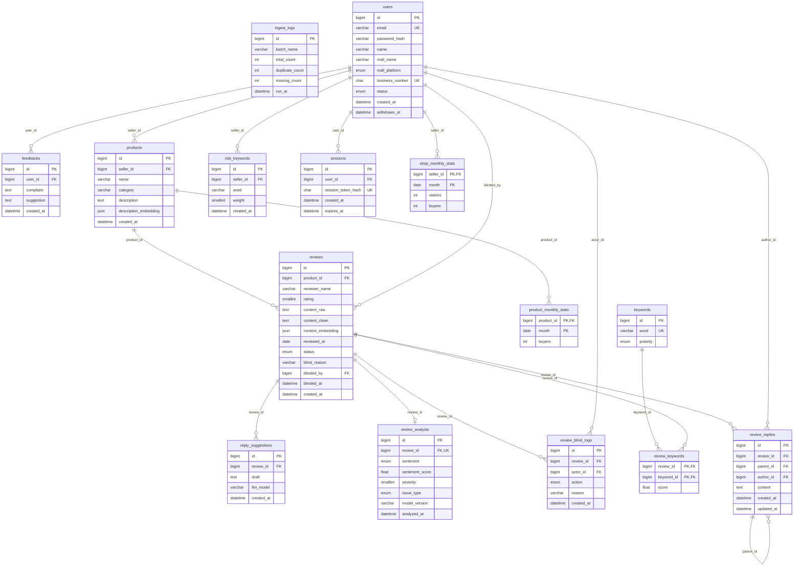

# 04. DB 설계 (ERD) — PIN POINT REVIEW

- DBMS: **MariaDB 10.5+**, 문자셋 `utf8mb4`, 엔진 InnoDB
- 실제 정의: `backend/models.py` (SQLAlchemy ORM) · 같은 내용의 DDL: `backend/schema_mariadb.sql`
- ID 는 모두 `BIGINT UNSIGNED AUTO_INCREMENT` (대리키). 월별 통계 2개만 복합 기본키

## 0. ERD (텍스트 버전)

위 그림과 같은 내용을 GitHub 에서 바로 보이는 Mermaid 로 옮겼습니다. `backend/models.py` 에서 **자동으로 뽑은 것**이라 실제 테이블·컬럼과 같습니다 (PK 기본키, FK 외래키, UK 고유).

**3일차 검증 질문에 대한 답:** 테이블 15개 · 각 테이블의 PK 는 아래 1장 · 관계는 2장 · Frontend 가 부르는 API 는 `03_ui_design.md` 5장 · Backend 가 돌려주는 데이터는 `05_api_spec.md` 응답 예시

## 1. 테이블 목록 (15개)

| 구분 | 테이블 | 설명 | 기본키(PK) | 외래키(FK) · 고유(UNIQUE) |
|---|---|---|---|---|
| 계정 | `users` | 셀러(서비스 이용자). `status` 는 ACTIVE 만 사용 (탈퇴는 행 삭제, WITHDRAWN 은 미사용) | id | UNIQUE email, business_number |
| 계정 | `sessions` | 로그인 세션. 토큰은 SHA-256 해시만 저장 | id | user_id → users (CASCADE) · UNIQUE session_token_hash |
| 상품 | `products` | 셀러의 상품 | id | seller_id → users (CASCADE) |
| 리뷰 | `reviews` | 수집한 리뷰. 원문(`content_raw`)과 정제본(`content_clean`) 분리 보존, `status` = VISIBLE / BLINDED | id | product_id → products (CASCADE) · blinded_by → users (SET NULL) |
| 리뷰 | `review_analysis` | 리뷰 1건당 분석 결과 1행: 감성·점수·위험도(0~3)·이슈 유형·모델 버전 | id | review_id → reviews (CASCADE) · UNIQUE review_id (1:1) |
| 리뷰 | `keywords` | 키워드 사전 ('배송 만족', '포장 불만', '환불' …) + 극성 | id | UNIQUE word |
| 리뷰 | `review_keywords` | 리뷰 ↔ 키워드 연결 (N:M 중간 테이블) + 중요도 | (review_id, keyword_id) | review_id → reviews, keyword_id → keywords (CASCADE) |
| 리뷰 | `review_blind_logs` | 블라인드·복구 이력 | id | review_id → reviews (CASCADE) · actor_id → users (SET NULL) |
| CS | `review_replies` | CS 답글 (답글의 답글 가능). CS챗봇 '처리 완료'도 여기에 저장 | id | review_id → reviews (CASCADE) · author_id → users (SET NULL) · parent_id → review_replies (CASCADE) |
| CS | `reply_suggestions` | 추천 답글(사과문) 생성 이력 | id | review_id → reviews (CASCADE) |
| 설정 | `risk_keywords` | 셀러별 위험 키워드와 가중치 | id | seller_id → users (CASCADE) · UNIQUE (seller_id, word) |
| 통계 | `shop_monthly_stats` | 쇼핑몰 월별 방문자·구매자 수 | (seller_id, month) | seller_id → users (CASCADE) |
| 통계 | `product_monthly_stats` | 상품 월별 구매자 수 | (product_id, month) | product_id → products (CASCADE) |
| 기타 | `ingest_logs` | 데이터 적재 이력 (총·중복·결측 건수) | id | - |
| 기타 | `feedbacks` | '의견 보내기' 내용 | id | user_id → users (SET NULL) |

## 2. 관계

| 관계 | 종류 | 의미 |
|---|---|---|
| users — products | 1 : N | 셀러 한 명이 여러 상품을 가짐 |
| products — reviews | 1 : N | 상품 하나에 여러 리뷰 |
| reviews — review_analysis | 1 : 1 | 리뷰마다 분석 결과 하나 |
| reviews — keywords | N : M | `review_keywords` 로 연결 (한 리뷰에 여러 키워드, 한 키워드가 여러 리뷰에) |
| reviews — review_replies | 1 : N | 리뷰 하나에 여러 답글. `parent_id` 로 답글의 답글(자기 참조) |
| reviews — review_blind_logs | 1 : N | 블라인드·복구할 때마다 이력 1행 |
| users — risk_keywords | 1 : N | 셀러마다 자기 위험 키워드 목록 |
| users / products — *_monthly_stats | 1 : N | 월마다 1행 |

## 3. 설계 규칙 (06_architecture.md 의 결정과 같음)

- **블라인드 = 소프트 삭제 (D2)**: 리뷰를 지우지 않고 `status = BLINDED` + 사유·처리자·시각 기록. 통계·위험 리뷰·키워드·CSV 는 모두 `VISIBLE` 만 집계
- **탈퇴 = 하드 삭제 (D5)**: `users` 행을 삭제. 외래키 규칙에 따라 세션·상품(→ 리뷰·분석·키워드 연결·답글·블라인드 이력)·위험 키워드·월별 통계는 `CASCADE` 로 함께 삭제, `feedbacks.user_id` 등은 `SET NULL`. 공용 키워드 사전(`keywords`)은 유지. 행이 사라지므로 같은 이메일·사업자번호로 재가입 가능 (UNIQUE 유지)
- **소유권**: 상품·리뷰·답글·위험 키워드는 `products.seller_id` 가 로그인한 셀러인 것만 접근 (API 403, 화면 404)
- **재분석 범위 식별**: `review_analysis.model_version` (지금은 `rule-v2`: 위험 키워드 없는 3점 리뷰를 중립으로 분류. 서버를 켤 때 예전 버전 결과는 자동 재분석)
- **임베딩 (D6)**: `products.description_embedding`, `reviews.content_embedding` JSON 컬럼 (현재 미사용, 컬럼만 유지)
